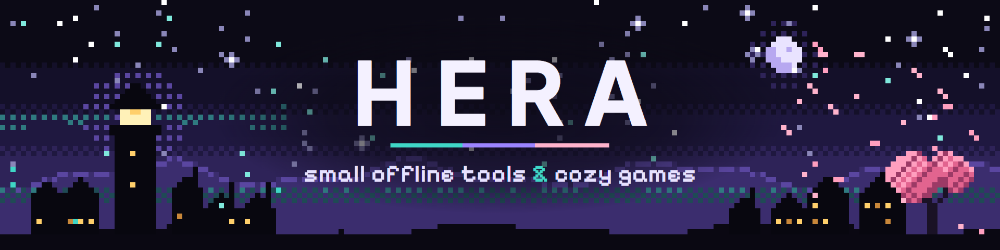

  

  <b>Small offline tools & cozy games.</b> 
  The tools are <b>free and open source</b> — read the code, build it yourself, open an issue. 
  <a href="https://heraklessi.itch.io">itch.io</a> · <a href="https://muitoon.com">muitoon.com</a>

---

## 🔓 Open source

Everything below is public, licensed and free. No accounts, no telemetry, no update pings.

| Project | What it does | Licence | Built with |
|---|---|---|---|
| [**Loomlight**](https://github.com/heraklessii/Loomlight) | Pixel art editor & sprite animator — layers, frames, GIF / sprite-sheet export, `.aseprite` import | GPL-3.0 | Electron · React · TypeScript |
| [**Muivly**](https://github.com/heraklessii/Muivly) | Live wallpaper engine for low-end PCs — GPU decode, zero work when hidden | Apache-2.0 | Rust · Tauri · Direct3D 11 |
| [**Muiren**](https://github.com/heraklessii/Muiren) | Desktop browser that sleeps idle tabs to save RAM | Apache-2.0 | Rust · Tauri · WebView2 |
| [**Muiply**](https://github.com/heraklessii/Muiply) | Local media player — MKV, HEVC, AV1, FLAC without codec packs | Apache-2.0 | Rust · Tauri · libmpv |
| [**Muiget**](https://github.com/heraklessii/Muiget) | Download manager — segmented downloads, resume, Chrome extension | Apache-2.0 | Rust · Tauri |
| [**Muifly**](https://github.com/heraklessii/Muifly) | Game performance tool for Windows — every change undoable in one click | Apache-2.0 | Rust · Tauri |
| [**Muiren Bot**](https://github.com/heraklessii/Muiren-bot) | Discord music bot | GPL-3.0 | Node.js · discord.js v14 |
| [**Ved: Recure TR**](https://github.com/heraklessii/ved-recure-turkce-yama) | Unofficial Turkish translation patch for *Ved: Recure* | see repo | Unity |

Found a bug or have an idea? Issues and pull requests are welcome on every repo.

## 🎮 Games & studio apps

Made by the same hands, sold on itch.io (source not public):

- 🌸 **[Petalfall](https://heraklessi.itch.io/petalfall)** — card game
- 🗼 **[Fogwardens](https://heraklessi.itch.io/fogwardens)** — hex city builder + tower defense *(free demo)*
- 🏘️ **[Muitown](https://heraklessi.itch.io/muitown)** — cozy low-poly city builder *(free demo)*
- 💬 **[Muita](https://heraklessi.itch.io/muita)** — typesetting studio for webtoons, manhwa and manga

---

🇹🇷 Merhaba! Araçlarımın hepsi ücretsiz ve açık kaynak: kodu okuyabilir, kendin derleyebilir, hata bildirebilirsin. Oyunlarım itch.io'da.
